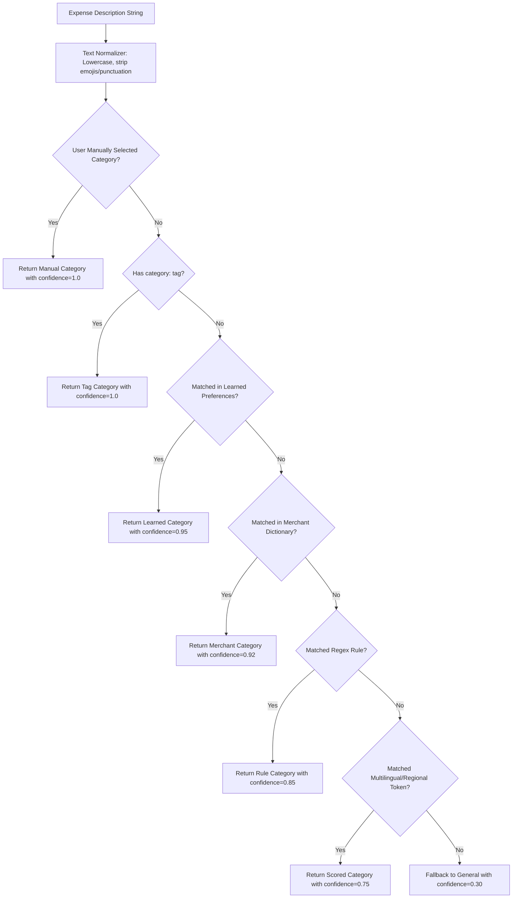

# Intelligent Category Detection Engine: Splitwiser

This document details the architecture, lexicon dictionaries, multi-stage detection pipeline, and machine learning mechanisms of the category detection engine (`src/services/categoryDetector/`).

---

## 1. 23 Canonical Categories & Metadata

The system classifies expenses into 23 canonical categories defined in `src/services/categoryDetector/categories.ts`:

| Category ID | Label | Accent Color | Light Tint | Example Items |
|---|---|---|---|---|
| `Food` | Food & Dining | `#EA580C` | `#FFEDD5` | Zomato, Swiggy, Dinner, Lunch, McDonald's, Biryani |
| `Coffee` | Coffee & Snacks | `#92400E` | `#FEF3C7` | Starbucks, Cafe, Blue Tokai, Chai, Croissant |
| `Drinks` | Drinks & Nightlife | `#D97706` | `#FEF3C7` | Beer, Wine, Cocktails, Bar, Pub, Brewery |
| `Transport` | Transport & Cab | `#0284C7` | `#E0F2FE` | Uber, Ola, Rapido, Metro, Taxi, Train, Auto |
| `Fuel` | Fuel & Gas | `#E11D48` | `#FFE4E6` | Petrol, Diesel, CNG, Shell, IndianOil, Gas Station |
| `Travel` | Travel & Trips | `#0891B2` | `#CFFAFE` | Flights, Hotel, Airbnb, Booking.com, Visa, Toll |
| `Groceries` | Groceries & Mart | `#059669` | `#D1FAE5` | Blinkit, Zepto, BigBasket, Supermarket, Milk, Vegetables |
| `Shopping` | Shopping | `#DB2777` | `#FCE7F3` | Amazon, Zara, H&M, Clothes, Shoes, Electronics |
| `Entertainment` | Entertainment | `#7C3AED` | `#EDE9FE` | Concert, Theme Park, Museum, Bowling, Zoo |
| `Movies` | Movies & Cinema | `#9333EA` | `#F3E8FF` | PVR, INOX, Cinema, IMAX, Movie Tickets |
| `Games` | Games & Gaming | `#4F46E5` | `#EEF2FF` | Steam, PlayStation, Xbox, Nintendo, Board Games |
| `Utilities` | Utilities & Bills | `#2563EB` | `#DBEAFE` | Electricity, Water, Gas Cylinder, Trash, Maintenance |
| `Electricity` | Electricity Bill | `#EAB308` | `#FEF9C3` | Power bill, Bijli, Electric board |
| `Water` | Water Bill | `#06B6D4` | `#CFFAFE` | Water tanker, Municipal water bill, Paani bill |
| `Internet` | Wi-Fi & Internet | `#3B82F6` | `#DBEAFE` | Broadband, Airtel, JioFiber, ACT, Wi-Fi |
| `Rent` | Rent & Housing | `#DC2626` | `#FEE2E2` | Apartment rent, Flat rent, PG rent, Deposit |
| `Maintenance` | Maintenance | `#64748B` | `#F1F5F9` | Society maintenance, AC service, Plumber, Repair |
| `Health` | Health & Medicine | `#10B981` | `#D1FAE5` | Apollo, Pharmacy, Doctor, Hospital, Dawai |
| `Fitness` | Fitness & Gym | `#14B8A6` | `#CCFBF1` | Cult.fit, Gym membership, Yoga, Protein, Sports |
| `Education` | Education & Books | `#8B5CF6` | `#EDE9FE` | Books, Course, Tuition, College, School, Udemy |
| `Gifts` | Gifts & Donations | `#F43F5E` | `#FFE4E6` | Birthday gift, Wedding gift, Flowers, Donation |
| `Subscriptions` | Subscriptions | `#6366F1` | `#EEF2FF` | Netflix, Spotify, Prime, YouTube Premium, Google One |
| `General` | General | `#6B7280` | `#F3F4F6` | Default fallback when confidence is low |

---

## 2. Multi-Stage Pipeline Architecture

---

## 3. Merchant & Multilingual Lexicons

### 3.1 Merchant Dictionary (`src/services/categoryDetector/merchants.ts`)
Maps 100+ global and Indian merchant brands directly to their category:
- **Food**: `swiggy`, `zomato`, `mcdonalds`, `dominos`, `kfc`, `burger king`, `subway`, `haldirams`
- **Coffee**: `starbucks`, `third wave coffee`, `blue tokai`, `costa coffee`, `cafe coffee day`, `dunkin`
- **Groceries**: `blinkit`, `zepto`, `instamart`, `bigbasket`, `dmart`, `nature's basket`, `spencer's`
- **Transport**: `uber`, `ola`, `rapido`, `lyft`, `grab`, `blablacar`
- **Subscriptions**: `netflix`, `spotify`, `hotstar`, `amazon prime`, `youtube premium`, `apple music`, `google one`
- **Health**: `apollo pharmacy`, `pharmeasy`, `tata 1mg`, `medplus`, `netmeds`
- **Fitness**: `cult.fit`, `anytime fitness`, `gold's gym`, `decathlon`

### 3.2 Multilingual Dictionary (`src/services/categoryDetector/multilingual.ts`)
Recognizes keywords across 10 languages:
- **Spanish**: `almuerzo` (Food), `cerveza` (Drinks), `supermercado` (Groceries)
- **French**: `dîner` (Food), `billet de train` (Transport), `electricite` (Utilities)
- **Portuguese**: `jantar` (Food), `onibus` (Transport), `sacolao` (Groceries)
- **Indonesian**: `makan siang` (Food), `token listrik` (Utilities)
- **Mandarin**: `吃午餐` (Food), `打出租车` (Transport), `超市买菜` (Groceries)
- **Japanese**: `ランチ` (Food), `ホテル予約` (Travel), `電車` (Transport)
- **Arabic**: `مطعم` (Food), `كهرباء` (Utilities), `فندق` (Travel)

### 3.3 Regional & Hinglish Lexicon (`src/services/categoryDetector/regionalVocab.ts`)
Tailored for Indian everyday living:
- `chai`, `nashta`, `biryani`, `tiffin` $\to$ `Food` / `Coffee`
- `bijli bill`, `paani bill`, `mobile recharge` $\to$ `Utilities`
- `kirana`, `sabji mandi`, `doodh`, `dahi`, `atta`, `chawal` $\to$ `Groceries`
- `auto rickshaw`, `petrol pump` $\to$ `Transport` / `Fuel`
- `dawai`, `chemist` $\to$ `Health`
- `pg rent`, `ghar bhada` $\to$ `Rent`

---

## 4. Machine Learned Preferences (`learnedPreferences.ts`)

When a user repeatedly edits the category of a description (e.g. changing `"Amazon Fresh"` from `Shopping` to `Groceries`), the system records this mapping in `AsyncStorage`:
- **Storage Key**: `@category_learned_prefs`
- **Structure**: Map of normalized description string $\to$ target `ExpenseCategory`.
- On future entries, the learned mapping triggers at Stage 3 with 0.95 confidence.

---

## 5. Strict User Override Invariant

> **Critical Rule**: A user-selected category is **immutable**.
> If `manualCategory` is provided (e.g., when editing an expense or when the user explicitly taps a category badge in `AddExpenseScreen`), the detection engine short-circuits and **never overwrites** the user's explicit choice.

