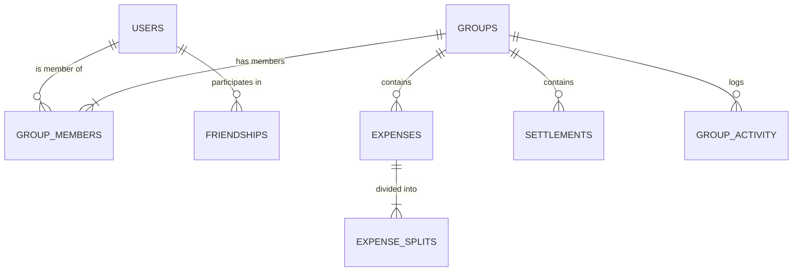

# Database Schema & Data Models: Splitwiser

This document provides the complete schema specification for both Cloud Firestore and the local SQLite database.

---

## 1. Cloud Firestore Collection Architecture

All Firestore documents reside under the primary namespace `/splitwiser/data/`.



### 1.1 Collection: `splitwiser/data/users/{uid}`
Stores centralized user profile information.

| Field | Type | Required | Description |
|---|---|---|---|
| `uid` | `string` | Yes | Firebase Auth UID |
| `name` | `string` | Yes | Display name |
| `email` | `string` | No | Associated email address |
| `phone` | `string` | No | Associated phone number |
| `isAnonymous` | `boolean` | Yes | True if user hasn't linked permanent credentials |
| `authProvider` | `string` | No | `'google'`, `'anonymous'`, `'email'`, etc. |
| `imageUrl` | `string` | No | Active resolved display avatar URL |
| `customPhotoUrl` | `string` | No | URL of manually uploaded picture in Firebase Storage |
| `googlePhotoUrl` | `string` | No | URL of Google account photo from OAuth provider data |
| `photoSource` | `string` | No | Active photo source: `'custom'`, `'google'`, or `'none'` |
| `currency` | `string` | No | Default currency code (e.g. `'INR'`, `'USD'`) |
| `timezone` | `string` | No | User timezone |
| `language` | `string` | No | Preferred app language |
| `createdAt` | `Timestamp` | Yes | Account creation timestamp |
| `updatedAt` | `Timestamp` | Yes | Last update timestamp |

---

### 1.2 Collection: `splitwiser/data/groups/{groupId}`
Stores high-level group metadata.

| Field | Type | Required | Description |
|---|---|---|---|
| `id` | `string` | Yes | Unique group UUID |
| `name` | `string` | Yes | Group title |
| `type` | `string` | No | `'home'`, `'trip'`, `'couple'`, `'family'`, `'friends'`, `'office'`, `'other'` |
| `description` | `string` | No | Group description |
| `currency` | `string` | Yes | Group base currency code (defaults to `'INR'`) |
| `joinCode` | `string` | Yes | Unique 6-character alphanumeric join code |
| `createdBy` | `string` | Yes | UID of group creator |
| `createdAt` | `Timestamp` | Yes | Creation timestamp |
| `updatedAt` | `Timestamp` | Yes | Last update timestamp |
| `imageUrl` | `string` | No | Group avatar icon URL |
| `bannerUrl` | `string` | No | Legacy banner URL |
| `coverPhoto` | `Map` | No | Cover photo metadata map: |
| ↳ `type` | `string` | Yes | `'preset'` or `'custom'` |
| ↳ `imageUrl` | `string` | Yes | Public image URL |
| ↳ `presetId` | `string` | No | Preset catalog identifier (e.g. `'cozy-home'`) |
| ↳ `storagePath` | `string` | No | Cloud storage path if custom |
| ↳ `updatedAt` | `string` | No | ISO timestamp string |
| ↳ `updatedBy` | `string` | No | UID of user who updated the cover |
| `memberIds` | `string[]` | Yes | Array of member UIDs for query filtering |
| `settings` | `Map` | No | Group settings: |
| ↳ `simplifyDebts` | `boolean` | No | True if debt minimization graph enabled (default: true) |
| ↳ `defaultSplitType` | `string` | No | Default split type for new expenses |
| ↳ `memberPermissions` | `string` | No | `'anyone'` or `'admin_only'` |
| `isArchived` | `boolean` | No | True if group is archived |
| `isDeleted` | `boolean` | No | Soft deletion flag |

---

### 1.3 Subcollection: `splitwiser/data/groups/{groupId}/members/{userId}`
Stores member participation records within a group.

| Field | Type | Required | Description |
|---|---|---|---|
| `userId` | `string` | Yes | Member UID |
| `userName` | `string` | Yes | Member display name snapshot |
| `role` | `string` | Yes | `'admin'` or `'member'` |
| `joinedAt` | `Timestamp` | Yes | Join timestamp |
| `imageUrl` | `string` | No | Member avatar URL snapshot |

---

### 1.4 Subcollection: `splitwiser/data/groups/{groupId}/expenses/{expenseId}`
Stores financial expenses within a group.

| Field | Type | Required | Description |
|---|---|---|---|
| `id` | `string` | Yes | Unique expense UUID |
| `groupId` | `string` | Yes | Parent group UUID |
| `createdBy` | `string` | Yes | Author UID |
| `paidBy` | `string` | Yes | Primary payer UID (or first payer if multi-payer) |
| `description` | `string` | Yes | Expense item description |
| `amount` | `number` | Yes | Total monetary amount in major units |
| `splitType` | `string` | Yes | `'equal'`, `'unequal'`, `'percentage'`, `'shares'`, `'adjustment'`, `'itemized'` |
| `splits` | `Map[]` | Yes | Array of participant split allocations: |
| ↳ `userId` | `string` | Yes | Participant UID |
| ↳ `amount` | `number` | Yes | Amount owed in major units |
| ↳ `type` | `string` | Yes | Split mode |
| `currency` | `string` | Yes | Currency code |
| `tags` | `string[]` | Yes | Tags (e.g. `['category:Food']`, `['payer:uid:amount']`) |
| `createdAt` | `Timestamp` | Yes | Expense creation date |
| `updatedAt` | `Timestamp` | Yes | Last update date |
| `isDeleted` | `boolean` | No | Soft deletion flag |

---

### 1.5 Subcollection: `splitwiser/data/groups/{groupId}/settlements/{settlementId}`
Stores recorded debt settlements.

| Field | Type | Required | Description |
|---|---|---|---|
| `id` | `string` | Yes | Settlement UUID |
| `groupId` | `string` | Yes | Parent group UUID |
| `fromUserId` | `string` | Yes | Debtor UID (who paid the money) |
| `toUserId` | `string` | Yes | Creditor UID (who received the money) |
| `fromUserName` | `string` | Yes | Snapshot of debtor display name |
| `toUserName` | `string` | Yes | Snapshot of creditor display name |
| `amount` | `number` | Yes | Amount paid |
| `status` | `string` | Yes | `'completed'` or `'pending'` |
| `note` | `string` | No | Optional settlement note |
| `createdAt` | `Timestamp` | Yes | Settlement date |
| `isDeleted` | `boolean` | No | Soft deletion flag |

---

## 2. Local SQLite Schema (`splitwiser_offline.db`)

All tables use SQLite WAL mode with full indexation.

### `local_users`
```sql
CREATE TABLE IF NOT EXISTS local_users (
  uid TEXT PRIMARY KEY,
  name TEXT NOT NULL,
  email TEXT,
  is_anonymous INTEGER NOT NULL DEFAULT 0,
  photo_url TEXT,
  updated_at INTEGER NOT NULL
);
```

### `local_groups`
```sql
CREATE TABLE IF NOT EXISTS local_groups (
  id TEXT PRIMARY KEY,
  name TEXT NOT NULL,
  currency TEXT NOT NULL DEFAULT 'INR',
  join_code TEXT,
  created_by TEXT NOT NULL,
  created_at INTEGER NOT NULL,
  image_url TEXT,
  banner_url TEXT,
  icon TEXT,
  member_ids_json TEXT NOT NULL DEFAULT '[]',
  updated_at INTEGER NOT NULL,
  sync_status TEXT NOT NULL DEFAULT 'synced',
  is_deleted INTEGER NOT NULL DEFAULT 0
);
```

### `local_group_members`
```sql
CREATE TABLE IF NOT EXISTS local_group_members (
  group_id TEXT NOT NULL,
  user_id TEXT NOT NULL,
  user_name TEXT NOT NULL,
  role TEXT NOT NULL DEFAULT 'member',
  joined_at INTEGER NOT NULL,
  image_url TEXT,
  PRIMARY KEY (group_id, user_id)
);
```

### `local_expenses`
```sql
CREATE TABLE IF NOT EXISTS local_expenses (
  id TEXT PRIMARY KEY,
  group_id TEXT NOT NULL,
  created_by TEXT NOT NULL,
  paid_by TEXT NOT NULL,
  description TEXT NOT NULL,
  amount REAL NOT NULL,
  split_type TEXT NOT NULL,
  splits_json TEXT NOT NULL,
  currency TEXT NOT NULL DEFAULT 'INR',
  tags_json TEXT NOT NULL DEFAULT '[]',
  created_at INTEGER NOT NULL,
  updated_at INTEGER NOT NULL,
  sync_status TEXT NOT NULL DEFAULT 'synced',
  is_deleted INTEGER NOT NULL DEFAULT 0
);
```

### `local_settlements`
```sql
CREATE TABLE IF NOT EXISTS local_settlements (
  id TEXT PRIMARY KEY,
  group_id TEXT NOT NULL,
  from_user_id TEXT NOT NULL,
  to_user_id TEXT NOT NULL,
  from_user_name TEXT NOT NULL,
  to_user_name TEXT NOT NULL,
  amount REAL NOT NULL,
  status TEXT NOT NULL DEFAULT 'completed',
  note TEXT,
  created_at INTEGER NOT NULL,
  sync_status TEXT NOT NULL DEFAULT 'synced',
  is_deleted INTEGER NOT NULL DEFAULT 0
);
```

### `local_friendships`
```sql
CREATE TABLE IF NOT EXISTS local_friendships (
  id TEXT PRIMARY KEY,
  user_id TEXT NOT NULL,
  friend_id TEXT NOT NULL,
  friend_name TEXT NOT NULL,
  friend_email TEXT,
  friend_photo_url TEXT,
  status TEXT NOT NULL DEFAULT 'accepted',
  initiated_by TEXT NOT NULL,
  created_at INTEGER NOT NULL,
  updated_at INTEGER NOT NULL,
  sync_status TEXT NOT NULL DEFAULT 'synced',
  is_deleted INTEGER NOT NULL DEFAULT 0
);
```

### `sync_queue` (Durable Transaction Queue)
```sql
CREATE TABLE IF NOT EXISTS sync_queue (
  id TEXT PRIMARY KEY,
  entity_type TEXT NOT NULL,
  entity_id TEXT NOT NULL,
  operation TEXT NOT NULL,
  payload_json TEXT NOT NULL,
  created_at INTEGER NOT NULL,
  attempts INTEGER NOT NULL DEFAULT 0,
  last_attempt_at INTEGER,
  error_message TEXT,
  status TEXT NOT NULL DEFAULT 'pending'
);
```

### `sync_metadata` (Synchronization Cursors)
```sql
CREATE TABLE IF NOT EXISTS sync_metadata (
  key TEXT PRIMARY KEY,
  value TEXT NOT NULL,
  updated_at INTEGER NOT NULL
);
```

### High-Performance Query Indexes
```sql
CREATE INDEX IF NOT EXISTS idx_expenses_group_created 
  ON local_expenses (group_id, is_deleted, created_at DESC);

CREATE INDEX IF NOT EXISTS idx_expenses_sync_status 
  ON local_expenses (sync_status);

CREATE INDEX IF NOT EXISTS idx_settlements_group_created 
  ON local_settlements (group_id, is_deleted, created_at DESC);

CREATE INDEX IF NOT EXISTS idx_members_group 
  ON local_group_members (group_id);

CREATE INDEX IF NOT EXISTS idx_friendships_user 
  ON local_friendships (user_id, is_deleted);

CREATE INDEX IF NOT EXISTS idx_queue_status_created 
  ON sync_queue (status, created_at ASC);
```

