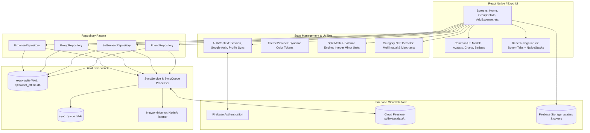
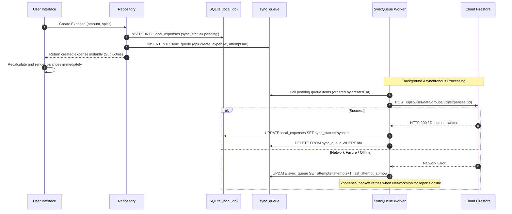

# Technical Architecture: Splitwiser

This document provides an exhaustive technical analysis of the application's software architecture, patterns, offline engine, and data flows.

---

## 1. High-Level Architecture Diagram



---

## 2. Navigation Architecture

Splitwiser utilizes `@react-navigation/native` v7 with a layered hierarchy:

```
AppNavigator (Root Stack)
├── [Gated on !user]: OnboardingScreen
└── [Gated on user]: MainNavigator (Bottom Tabs)
    ├── Groups Tab -> GroupsStackNavigator (Native Stack)
    │   ├── Home (HomeScreen)
    │   ├── CreateGroup (CreateGroupScreen - slide from bottom)
    │   ├── GroupDetails (GroupDetailsScreen)
    │   ├── AddExpense (AddExpenseScreen)
    │   ├── GroupSettings (GroupSettingsScreen)
    │   └── JoinGroup (JoinGroupScreen)
    ├── Friends Tab -> FriendsStackNavigator (Native Stack)
    │   ├── FriendsHome (FriendsScreen)
    │   ├── FriendDetails (FriendDetailsScreen)
    │   ├── AddExpense (AddExpenseScreen)
    │   └── GroupDetails (GroupDetailsScreen)
    ├── Statistics Tab -> StatisticsScreen (Standalone Tab)
    └── Account Tab -> AccountStackNavigator (Native Stack)
        ├── AccountHome (AccountScreen)
        └── EditProfile (EditProfileScreen)
```

### Navigation Design Rationale
- **Native Stack Performance**: Uses `@react-navigation/native-stack` powered by `react-native-screens` for genuine native Android Fragment and Jetpack Navigation screen transitions.
- **Smooth Splash Screen Dismissal**: `AppNavigator` coordinates with `expo-splash-screen` to hold the native splash screen until authentication state and initial SQLite tables are warmed up, eliminating UI flickering.

---

## 3. Data Layer: Repository Pattern & Offline SQLite

To maintain strict separation of concerns, screens never execute raw SQL or call Firestore queries directly. All data access flows through dedicated repositories:

```
src/repositories/
├── expenseRepository.ts     # CRUD for local_expenses + remote upsert
├── groupRepository.ts       # CRUD for local_groups & local_group_members
├── settlementRepository.ts  # CRUD for local_settlements
└── friendRepository.ts      # CRUD for local_friendships
```

### Local Database Configuration (`src/db/sqlite.ts`)
- **Engine**: `expo-sqlite` (version 58+ asynchronous API).
- **Database File**: `splitwiser_offline.db`.
- **Pragmas**:
  - `PRAGMA journal_mode = WAL;` (Write-Ahead Logging allows simultaneous concurrent reads while writing).
  - `PRAGMA synchronous = NORMAL;` (Maximizes write performance while maintaining crash resistance).
  - `PRAGMA foreign_keys = ON;` (Enforces referential integrity).

---

## 4. Synchronization Architecture (`src/sync/`)



### Two-Way Synchronization Principles
1. **Local-First Writes**: Every user action is written immediately to SQLite. The UI never waits for a cloud round-trip.
2. **Durable Queuing**: Mutations are stored in `sync_queue` on disk. If the app is killed or loses battery, queued mutations persist across restarts.
3. **Real-Time Remote Ingestion**: When connected, `SyncService` maintains Firestore `onSnapshot` listeners on groups the user belongs to. Remote updates are upserted into SQLite and broadcast to active UI listeners.
4. **Soft Deletions**: Deletions are written with `is_deleted = 1`. This allows sync workers to replicate deletions to the cloud without losing local reconciliation state.

---

## 5. Storage & Image Compression Pipeline

Avatars and cover images pass through an on-device optimization pipeline before transmission:

```
User Gallery / Camera (Raw 5MB - 15MB Photo)
        │
        ▼
expo-image-picker (Cropping: 1:1 for Avatars, 16:9 for Covers)
        │
        ▼
expo-image-manipulator (Bounded: 400x400 for Avatars, 1280x720 for Covers)
JPEG Compression: quality = 0.75
        │
        ▼
Optimized File: ~30KB (Avatars), ~120KB (Covers)
        │
        ▼
Firebase Storage Upload:
  • Avatars: users/{uid}/profile/avatar_{timestamp}.jpg
  • Covers:  groups/{groupId}/covers/cover_{timestamp}.jpg
```

---

## 6. Security Architecture

1. **Authentication State Persistence**: Handled via `firebase/auth` configured with React Native `AsyncStorage` persistence.
2. **Firestore Namespacing**: All application documents live strictly under the `/splitwiser/data/` root namespace to isolate Splitwiser data from other platform apps.
3. **Client-Side Validation**: All monetary totals, split allocations, and participant permissions are validated in TypeScript before persistence.

---

## 7. Android Platform Architecture & Build System

Splitwiser is targeted exclusively for the **Android OS ecosystem**.

- **Target SDK**: Android 35 (Android 15 ready)
- **Compile SDK**: Android 35
- **Package Name**: `com.splitwiser.app`
- **Native Services**: Google Play Services (OAuth Authentication via `google-services.json`)
- **Build Targets**:
  - `npm run build:apk`: Builds a local standalone preview APK for direct sideloading and testing on Android devices.
  - `npm run build:aab`: Builds a production Android App Bundle (AAB) for Google Play Store publishing.
- **Orientation & Hardware**: Locked to `portrait`, fully utilizing Android hardware back-button handling, safe area window insets (`react-native-safe-area-context`), and native Android vibration channels.


---

## 8. Internationalization (i18n) Architecture

Splitwiser features a comprehensive, offline-first multilingual system supporting 8 global languages.

```
                    ┌────────────────────────────────────────┐
                    │      Device / User Locale Request      │
                    └───────────────────┬────────────────────┘
                                        │
             ┌──────────────────────────┴──────────────────────────┐
             ▼                                                     ▼
┌──────────────────────────┐                             ┌───────────────────┐
│ Manual User Preference   │                             │  System Detection │
│ (AsyncStorage/Firestore) │                             │(expo-localization)│
└────────────┬─────────────┘                             └─────────┬─────────┘
             │                                                     │
             │                   normalizeLocale()                 │
             └──────────────────────────┬──────────────────────────┘
                                        │
                                        ▼
                         ┌─────────────────────────────┐
                         │ Selected Language (8 tiers) │
                         │ en | zh-Hans | es | ar |    │
                         │ fr | pt-BR | id | ru        │
                         └──────────────┬──────────────┘
                                        │
                         ┌──────────────┴──────────────┐
                         ▼                             ▼
              LTR Layout Engine              RTL Engine (Arabic)
              (Default Direction)            (I18nManager.forceRTL)
                         │                             │
                         └──────────────┬──────────────┘
                                        │
                                        ▼
                    ┌────────────────────────────────────────┐
                    │  15 Pre-bundled Offline Namespaces     │
                    │  (common, auth, home, groups, friends, │
                    │   expenses, split, balances, etc.)     │
                    └───────────────────┬────────────────────┘
                                        │
                                        ▼
                    ┌────────────────────────────────────────┐
                    │  Pure Localized UI Components & Hooks  │
                    │  • useTranslation([ns])                │
                    │  • useI18n() (formatAmount, formatDate)│
                    │  • LanguagePickerModal                 │
                    └────────────────────────────────────────┘
```

### Key Architectural Tenets
1. **Zero Runtime Network Requirement**: All 120 locale JSON dictionaries are bundled statically. The application operates 100% offline in all 8 languages.
2. **Immutable Financial Calculations**: Currency amounts, split math, integer minor units, and balances are language-neutral and calculated with strict mathematical bounds.
3. **UGC Preserved**: User-entered expense descriptions, personal notes, and group names are never auto-translated or altered.
4. **Canonical Category Identifiers**: Database category IDs (`Food`, `Coffee`, etc.) remain permanent and unchanged; only UI presentation is localized via `getCategoryLabel(category)`.
5. **Arabic RTL Support**: Native direction flipping via React Native `I18nManager` when switching between LTR languages and Arabic.
6. **Per-Recipient Push Notifications**: Remote notification payloads utilize user-specific language preferences stored in Firestore profiles.
