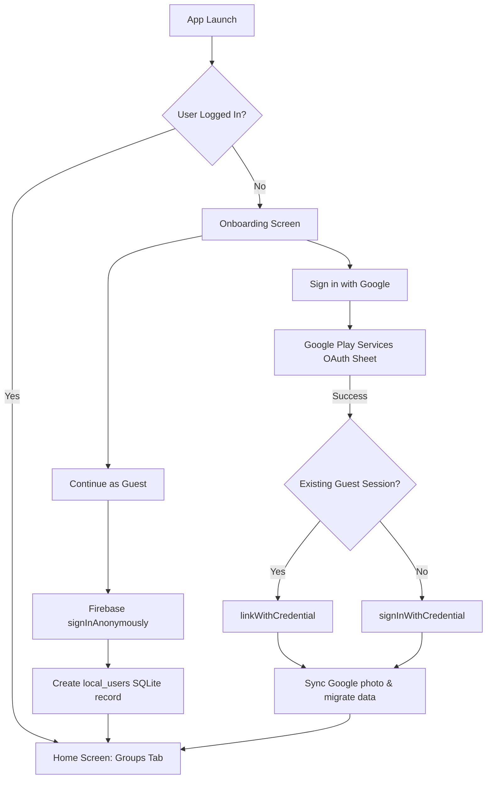
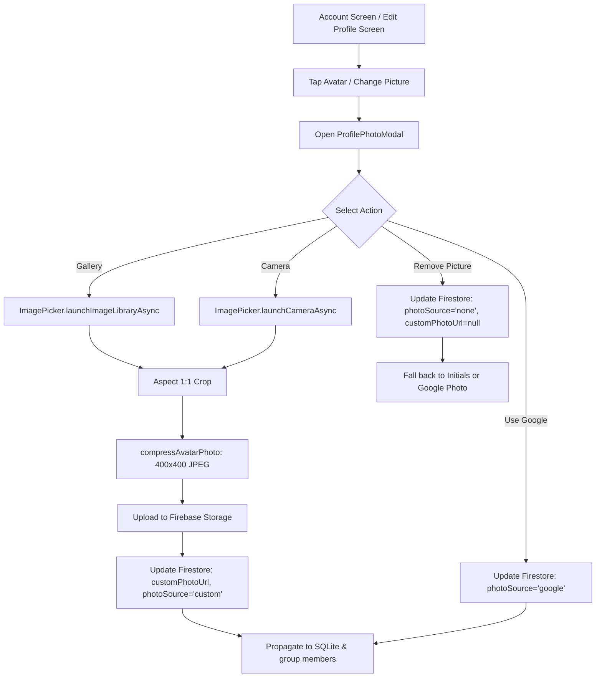
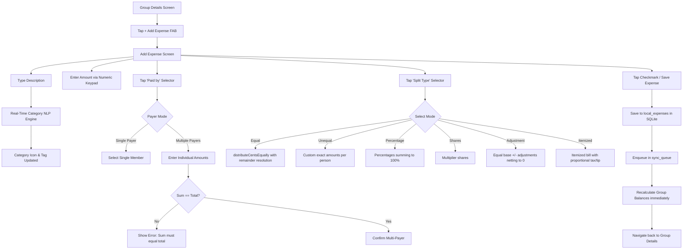
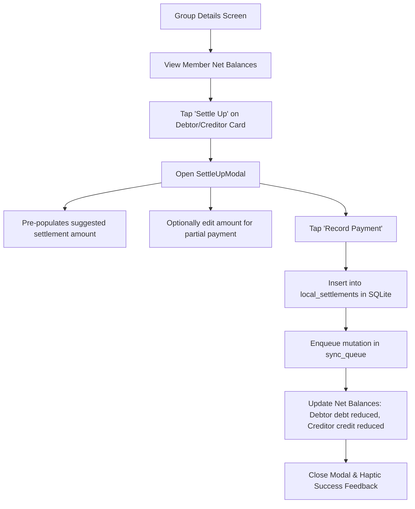
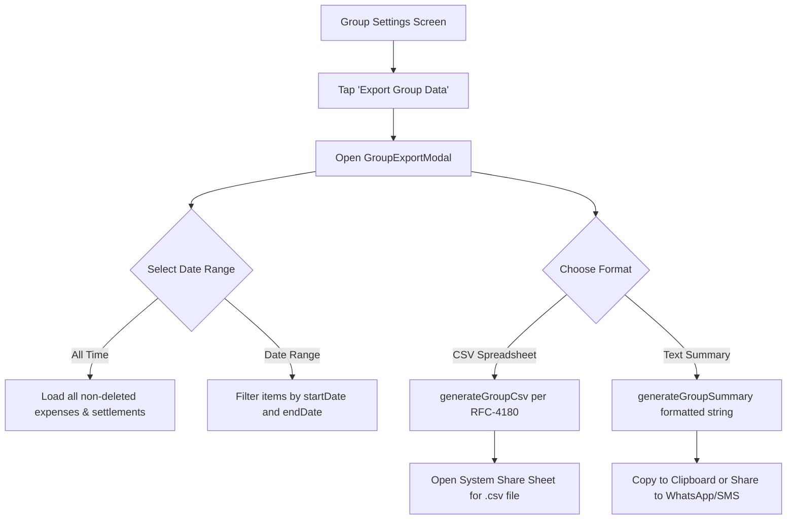

# User Flows & Journey Maps: Splitwiser

This document maps out the critical user journeys through the application, including screen sequences, user actions, state changes, error boundaries, and edge cases.

---

## 1. Authentication & Onboarding Flow



### Edge Cases
- **Google Play Services Missing**: Handled cleanly with an error alert prompting the user to continue as a guest.
- **Account Linking Conflict**: If the Google account is already registered to a different UID, anonymous data is gracefully merged into the existing Firestore profile without wiping either record.

---

## 2. Profile Picture Management Flow



### Critical Invariants
- When a user uploads a custom photo, `photoSource` is set to `'custom'`. Subsequent Google authentication refreshes will **never** overwrite `customPhotoUrl` or revert `photoSource` to `'google'`.

---

## 3. Expense Creation & Splitting Flow



---

## 4. Group Settlement ("Settle Up") Flow



---

## 5. Group Cover Photo Customization Flow

```mermaid
flowchart TD
    GroupDetails[Group Details Screen] --> TapCoverCamera[Tap Camera Button on Cover Banner]
    TapCoverCamera --> OpenCoverModal[Open GroupCoverPhotoModal]
    
    OpenCoverModal --> SegmentChoice{Select Tab}
    
    SegmentChoice -- Presets --> ViewPresets[Browse 29 Curated Covers by Category]
    ViewPresets --> SelectPreset[Tap Preset Thumbnail]
    SelectPreset --> UpdateCoverDoc[Update Firestore & SQLite: type='preset', imageUrl, presetId]
    
    SegmentChoice -- Custom --> PickGalleryImage[ImagePicker.launchImageLibraryAsync with 16:9 crop]
    PickGalleryImage --> CompressBanner[compressCoverPhoto to 1280x720 JPEG]
    CompressBanner --> UploadCover[Upload to Firebase Storage: groups/{groupId}/covers/...]
    UploadCover --> UpdateCoverDocCustom[Update Firestore & SQLite: type='custom', imageUrl]
    
    UpdateCoverDoc --> SmoothUpdate[GroupCoverHeader updates smoothly without page jump]
    UpdateCoverDocCustom --> SmoothUpdate
```

---

## 6. Group Data Export Flow



